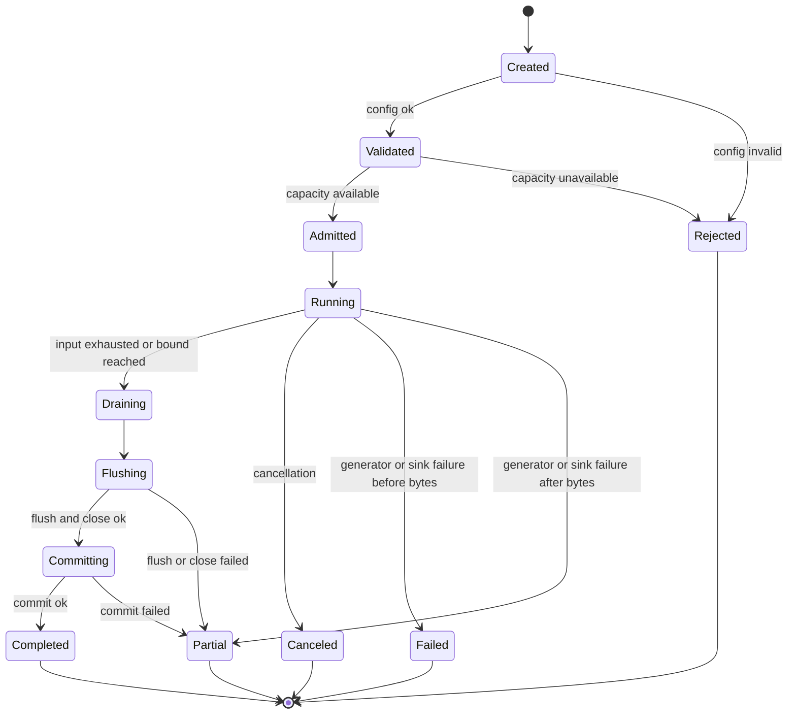
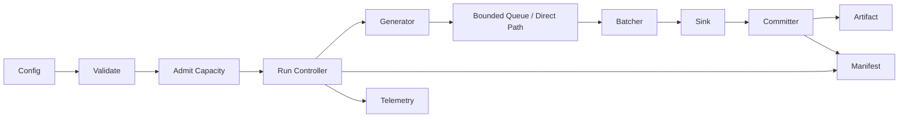

# Architecture

## Scope

`multiwrite` v1 is a bounded, reproducible write workload engine.

The system accepts a run configuration, validates it before work starts, generates a deterministic workload, writes bounded batches to a sink, commits or marks the output artifact, and emits a versioned manifest.

Deployment order:

- Docker Compose
- k3s

## v0 Baseline Gaps

v0 is retained as the baseline in `multiwrite/v0`.

Gaps:

- Loop timing excludes final `Flush` and `Close`.
- `Close` errors are ignored.
- Output reports records and elapsed time only.
- Inputs are not validated as a boundary contract.
- Records, bytes, duration, memory, queue depth, and disk use are not bounded.
- Random generation is not explicitly seeded.
- Output is written directly to the final path.
- Partial output is not classified.
- No manifest records run config, seed, environment, artifact state, or failure domain.
- No queueing, backpressure, cancellation, profiling, or deployment model exists.

## Run Contract

A run is valid when:

- Config validation completes before file creation and generation.
- Config contains explicit bounds for records, bytes, duration, queue depth, batch size, and buffer size.
- Workload generation is deterministic for the same binary version, config, seed, and profile.
- Writer accounting counts actual records and bytes accepted by the sink path.
- Flush, close, and commit are included in total lifecycle timing.
- Terminal state is one of `completed`, `partial`, `failed`, `canceled`, or `rejected`.
- Terminal state is represented in the manifest.
- Unknown failure is never reported as success.

## Core Entities

- `Run`: one execution with one terminal state.
- `RunConfig`: validated configuration.
- `WorkloadProfile`: deterministic record generation strategy.
- `Generator`: emits records from a seed and profile.
- `Record`: logical payload before batching.
- `Batch`: bounded byte group sent to a sink.
- `BoundedQueue`: backpressure boundary used when queued mode is enabled.
- `Sink`: storage target.
- `Committer`: transitions temp output to final or partial artifact.
- `OutputArtifact`: file plus artifact state.
- `ResultManifest`: versioned run evidence.
- `ErrorDomain`: stable failure classification.
- `MetricsSnapshot`: counters and timings.
- `LifecycleState`: run state.

## Configuration

Required config fields:

- `records_limit`
- `bytes_limit`
- `duration_limit`
- `output_path`
- `manifest_path`
- `seed`
- `workload_profile`
- `buffer_size`
- `batch_size`
- `queue_depth`
- `durability_mode`
- `overwrite_policy`

Profiling and policy config fields:

- `cpu_profile_path`
- `heap_profile_path`
- `trace_path`
- `allowed_output_root`
- `disk_free_margin`
- `max_queue_wait`

Validation rules:

- Numeric limits must be positive where zero has no defined meaning.
- `queue_depth = 0` means direct mode.
- Output path must satisfy the configured path policy.
- Existing output handling must follow `overwrite_policy`.
- Unknown workload profiles fail validation.
- Unknown durability modes fail validation.
- Unknown overwrite policies fail validation.

## Workload Profiles

Required profiles:

- `fixed`: deterministic fixed-size payloads.
- `tiny`: small records for per-record overhead.
- `wide`: large records for batch and byte accounting.
- `heavy-tail`: mixed record sizes with rare large records.
- `high-entropy`: low-compressibility payloads.
- `low-entropy`: repeated or compressible payloads.
- `burst`: time-correlated arrivals that can exceed sink service rate.

Every profile records:

- Name.
- Seed.
- Length distribution.
- Entropy class.

## Durability Modes

- `closed`: user-space buffer flush and file close succeeded.
- `synced`: file sync succeeded before close.
- `committed`: temp artifact was committed to the final path.

Throughput comparisons must include durability mode.

## Output Commit Policy

Writes target a temp artifact first.

Final artifact is produced only after the configured durability condition succeeds.

Artifact states:

- `none`: no bytes written.
- `temp`: temp artifact exists.
- `partial`: bytes exist but final commit did not complete.
- `final`: final artifact committed.
- `unknown`: artifact state could not be determined and success is forbidden.

Overwrite policies:

- `fail`: reject if final output exists.
- `replace`: replace final output only after successful temp commit.
- `version`: write a distinct final artifact name.

## Error Domains

Terminal failures map to one domain:

- `validation`
- `config`
- `filesystem`
- `timeout`
- `canceled`
- `resource_limit`
- `application_bug`

Raw internal errors are not part of the stable external contract.

## Manifest

Manifest format: JSON.

Required fields:

- `schema_version`
- `run_id`
- `binary_version` or git commit
- `started_at`
- `ended_at`
- `status`
- `error_domain`
- `config`
- `seed`
- `workload_profile`
- `records_requested`
- `records_generated`
- `records_written`
- `bytes_written`
- `duration_total_ms`
- `duration_flush_close_ms`
- `records_per_second`
- `mib_per_second`
- `artifact_state`
- `output_path`
- `environment`

Environment fields:

- `class`: `local`, `compose`, or `k3s`
- `os`
- `arch`
- `go_version`
- `cpu_limit`
- `memory_limit`
- `filesystem`
- `volume_kind`
- `container_image`, for Compose and k3s
- `storage_class`, for k3s
- `pvc_size_bytes`, for k3s
- `node_name`, for k3s when available

## Lifecycle

States:

- `created`
- `validated`
- `admitted`
- `running`
- `draining`
- `flushing`
- `committing`
- `completed`
- `partial`
- `failed`
- `canceled`
- `rejected`



## Data Flow



## Formal Model

State vector:

- `S(t) = {state, records_generated, records_written, bytes_written, queue_depth, batch_bytes, artifact_state, error_domain}`

Control vector:

- `U = {records_limit, bytes_limit, duration_limit, queue_depth, batch_size, buffer_size, durability_mode, overwrite_policy}`

External variables:

- `E = {filesystem_latency, page_cache_behavior, CPU_limit, memory_limit, disk_free_bytes, cancellation, sink_error}`

Objective:

- Maximize throughput subject to correctness, bounded resource use, deterministic reproduction, and explicit terminal state.

## Queueing Model

Arrival rates:

- `lambda_r`: records generated per second.
- `lambda_b`: bytes generated per second.

Service rates:

- `mu_r`: records written per second.
- `mu_b`: bytes written per second.

Utilization:

- `rho_r = lambda_r / mu_r`
- `rho_b = lambda_b / mu_b`

Rules:

- Queue depth never exceeds configured capacity.
- Batch bytes never exceed configured batch size.
- Sustained `rho >= 1` requires producer blocking, admission failure, or `resource_limit` termination.
- Accepted queue capacity is released exactly once.
- Peak queue depth is recorded in the manifest for queued runs.

## Information Model

Record stream:

- `X = {x_1, x_2, ..., x_n}`

Required accounting:

- Record count.
- Byte count.
- Length distribution.
- Entropy class.

Comparison rule:

- Two runs are comparable only when manifest fields match for binary version, config, seed, workload profile, durability mode, queue mode, batch size, buffer size, and environment class.

## Complexity Targets

- Generation: `O(records)`.
- Queueing: `O(records)`.
- Batching: `O(records + bytes)`.
- Writing: `O(bytes)`.
- Manifest emission: `O(1)` relative to output size.
- Generator state: `O(1)` per producer.
- Queue memory: `O(queue_depth * max_record_size)`.
- Batch memory: `O(batch_size)`.

## Observability

Required:

- Structured logs with run ID.
- Final JSON manifest.
- Progress snapshots at configured interval.
- Error-domain counters.
- Queue depth when queue mode is enabled.
- Write latency measurements.

Profiling outputs:

- CPU profile.
- Heap profile.
- Go trace.

Cardinality rule:

- Labels may include status, error domain, workload profile, durability mode, and environment class.
- Labels must not include raw payloads, raw output paths, or arbitrary user text.

## Reproducibility

A run is reproducible from:

- Binary version or git commit.
- Manifest schema version.
- Full validated config.
- Seed.
- Workload profile.
- Durability mode.
- Output commit policy.
- Environment class.
- Resource envelope.

Reproduction success requires:

- Identical deterministic payload bytes.
- Compatible terminal state under equivalent resource and sink conditions.
- Manifest-visible explanation for throughput differences.

## Interfaces

Required CLI:

```bash
multiwrite run \
  --records <record-count> \
  --max-bytes <byte-limit> \
  --max-duration <duration-limit> \
  --profile <profile> \
  --seed <seed> \
  --out <output-path> \
  --manifest <manifest-path> \
  --durability <closed|synced|committed> \
  --overwrite <fail|replace|version>
```

Required reproduction command:

```bash
multiwrite reproduce \
  --manifest <manifest-path> \
  --out <output-path>
```

Required comparison command:

```bash
multiwrite compare \
  --left <manifest-path> \
  --right <manifest-path>
```

Optional profiling flags:

- `--cpuprofile <path>`
- `--memprofile <path>`
- `--trace <path>`

## Deployment Order

### Docker Compose

Compose is the first environment boundary.

Requirements:

- Runs execute from the same CLI interface as local mode.
- Output, manifest, and profile paths are mounted artifacts.
- CPU and memory envelope are recorded in the manifest.
- Container image is recorded in the manifest.
- Missing writable artifact path fails before generation.

### k3s

k3s follows local and Compose reproduction.

Requirements:

- Finite runs execute as Kubernetes Jobs.
- PVC size and storage class are recorded.
- CPU and memory requests/limits are recorded.
- Pod termination state is reflected in terminal state and manifest.
- Rollback preserves manifest schema and artifact commit compatibility.
