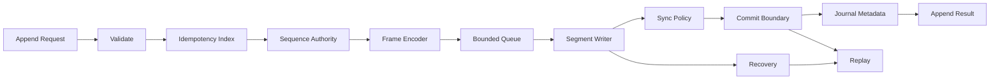
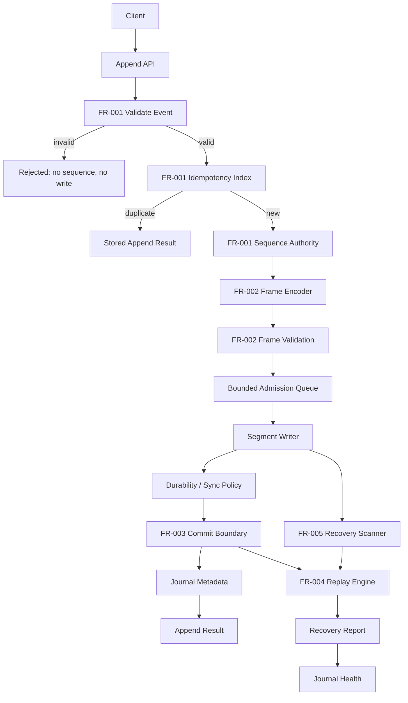
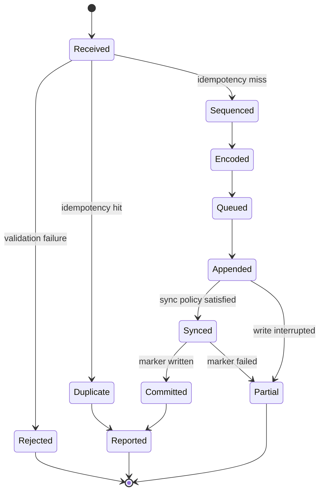
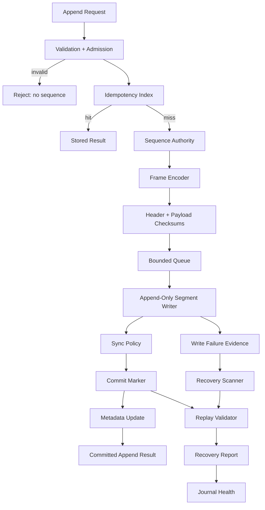

# Settlement Journal Design

## 1. Scope

v2 defines an append-only settlement journal.

The journal persists settlement events as framed, sequenced records. The persisted byte stream is the recovery source for committed settlement state.

v2 depends on v1 benchmark evidence for writer strategy, buffering, batch size, sync policy, and durability cost.

Out of scope:

- Settlement matching.
- Balance calculation.
- Clearing rules.
- External payment rail integration.
- Distributed consensus.

## 2. Problem

Settlement state must survive process failure, duplicate delivery, partial writes, corrupted bytes, and deployment rollback.

The journal must prove:

- what event was accepted
- which idempotency key was used
- which sequence was assigned
- which bytes were committed
- which prefix is replayable
- where recovery must stop

v0 provided a sequential write baseline. v1 turns that baseline into a write-path investigation. v2 applies the resulting evidence to a settlement journal with explicit framing, commit boundaries, replay, and recovery.

## 3. Design Inputs Required

- Settlement event payload schema.
- Journal authority model: single writer, leader, or partitioned writer.
- Sequence scope: global, per journal, per partition, or per account.
- Production durability mode.
- Segment rollover policy.
- Idempotency index implementation.
- Replay index implementation.
- Retention and archival policy.
- Compatibility policy for journal format versions.

## 4. Open Engineering Questions

These questions must be resolved before implementation choices are treated as production constraints.

### Happy Path

- What is the journal authority: single writer, single leader, partitioned writer, or external sequence service?
- What is the sequence scope: global, per journal, per partition, per account, or per asset pair?
- Does append success require `written`, `flushed`, `synced`, `commit-marker-written`, or `metadata-updated` durability?
- Does segment creation or rollover require durable parent directory sync?
- Is the idempotency index stored inside the journal, derived from replay, or maintained as an external dependency?
- Does replay reconstruct journal records only, or also derived settlement state?
- Can one active segment contain committed and uncommitted records?
- Can multiple append requests share one commit marker?
- Is batch append part of the API, or is batching purely internal?
- Does duplicate idempotency return the exact prior response or a semantically equivalent response?

### Adversarial Path

- Same idempotency key, different payload: reject, return original result, or classify as conflict?
- Same settlement payload, different idempotency key: accept, reject, or domain-specific duplicate?
- Out-of-order producer input: reject, sequence by arrival, or sequence by event time?
- Disk full after frame write before marker: which error domain and artifact state?
- Sync success followed by metadata failure: can replay repair metadata from bytes?
- Commit marker present but metadata missing: recover automatically or require operator action?
- Corrupt segment: quarantine, truncate, leave immutable, or mark read-only?
- Checksum failure: classify as header corruption, payload corruption, marker corruption, or incompatible format?
- Storage timeout under retry: how is duplicate settlement prevented?
- Malicious idempotency keys: how are index hotspots bounded?

### Failure and Recovery

- What invariant detects incorrect idempotency scope?
- How is clock skew prevented from influencing journal order?
- How is version skew handled when an old reader sees a newer segment format?
- What is rollback behavior when new writer output cannot be parsed by old reader?
- Can telemetry failure block append or recovery?
- What prevents retention from deleting segments required for audit, replay, or dispute resolution?
- What is the recovery behavior for every row in the failure matrix?
- What evidence proves page-cache acceptance was not treated as durable settlement?
- What is the blast radius of one corrupt segment?

### UX

#### Developer

- What fixture generator creates valid, truncated, corrupt, missing-marker, and incompatible-version segments?
- What command runs local replay and emits a recovery report?
- What command checks journal format compatibility?
- Where is v1 benchmark evidence attached when changing sync, batch, or buffer policy?

#### Operator

- What command shows active segment, write offset, last appended sequence, last committed sequence, and last replayed sequence?
- What command runs read-only recovery?
- What states are operator-visible: healthy, degraded, partial, corrupt, incompatible, recovering, read-only?
- What actions are legal in each state?
- What runbook handles corrupt active segment?
- What alert fires when replay lag grows?

#### Service

- What is the append response schema?
- What headers carry request ID, idempotency key, journal ID, and sequence?
- Which errors are retryable?
- Which errors are terminal?
- Does startup block until recovery completes?
- Does incomplete recovery force read-only mode?
- How does readiness behave when append is unavailable but replay is available?

## 5. Requirements

### FR-001: Append Settlement Event

The journal must append a valid settlement event as one framed journal record.

Acceptance criteria:

- Invalid input is rejected before sequence assignment.
- Duplicate idempotency key returns the stored append result.
- New valid input receives the next sequence from the journal authority.
- Encoded record includes frame metadata, payload, and checksums.
- Append result includes idempotency result, sequence, commit status, and error domain.

Test coverage:

- Unit: validation and sequence assignment.
- Integration: append and replay.
- Contract: append response schema.
- Fuzz: event decoding.

### FR-002: Encode Journal Record

The journal must use a self-delimiting record frame.

Required frame fields:

- magic
- format version
- header length
- payload length
- sequence
- idempotency key hash
- payload checksum
- header checksum
- payload

Acceptance criteria:

- Parser rejects incomplete headers.
- Parser rejects truncated payloads.
- Parser rejects unsupported versions.
- Parser rejects payload length above configured limit.
- Parser rejects header checksum mismatch.
- Parser rejects payload checksum mismatch.

Test coverage:

- Unit: encoder and decoder.
- Property: encode/decode round trip.
- Fuzz: frame parser.

### FR-003: Commit Boundary

The journal must represent committed state with an explicit commit boundary.

Acceptance criteria:

- Commit boundary includes segment ID, last committed sequence, last committed byte offset, and marker checksum.
- Commit boundary is valid only if all prior frames verify.
- Replay ignores bytes after the last valid commit boundary.
- Append success cannot be returned before the configured durability condition completes.

Test coverage:

- Unit: marker validation.
- Integration: committed batch replay.
- Crash fixture: missing, partial, corrupt, and stale markers.

### FR-004: Replay

Replay must reconstruct the committed prefix deterministically.

Acceptance criteria:

- Replay validates magic, version, length, header checksum, payload checksum, sequence, and commit boundary.
- Replay emits records in journal sequence order.
- Replay stops at the last valid commit boundary.
- Replay emits a recovery report with terminal status, last valid sequence, last valid offset, and error domain.

Test coverage:

- Unit: replay validator.
- Integration: valid segment replay.
- Fuzz: malformed frames.
- Crash fixture: truncated and corrupt suffixes.

### FR-005: Recovery

Recovery must classify segment state before append traffic resumes.

Segment states:

- clean
- empty
- partial
- corrupt
- incompatible

Acceptance criteria:

- Recovery preserves the committed prefix.
- Recovery does not apply uncommitted bytes.
- Recovery does not mutate journal bytes in read-only mode.
- Recovery emits a recovery report.

Test coverage:

- Integration: clean recovery.
- Fault injection: disk and sync failures.
- Crash fixture: every failure point in the failure matrix.

## 6. Non-Functional Requirements

### Invariants

- Sequence is monotonic within the journal authority.
- A committed record is replayable.
- An uncommitted record is not applied as settlement state.
- One idempotency key maps to one append result.
- Partial frames are detected.
- Corrupt frames are detected.
- Recovery stops at a valid commit boundary.
- Unknown failure is not reported as successful settlement.

### Guarantees

- Deterministic replay for committed records.
- Prefix recovery after partial suffix failure.
- Stable error domains.
- Format versioning.
- Duplicate idempotency key returns the stored append result.

### Constraints

- Throughput cannot weaken commit semantics.
- Compression cannot hide frame corruption.
- Retention cannot remove records required for replay, audit, or dispute resolution.
- Rollback must preserve journal readability.
- Docker Compose validation precedes k3s validation.

## 7. Decoded Reality

### 7.1 Formal State

```text
J(t) = {
  segment_id,
  write_offset,
  next_sequence,
  last_appended_sequence,
  last_committed_sequence,
  last_committed_offset,
  idempotency_index_state,
  artifact_state,
  recovery_state
}
```

```text
A = {
  idempotency_key,
  payload,
  requested_durability,
  deadline
}
```

```text
R = {
  magic,
  version,
  header_length,
  payload_length,
  sequence,
  idempotency_key_hash,
  payload_checksum,
  header_checksum,
  payload
}
```

```text
C = {
  segment_id,
  last_sequence,
  last_offset,
  marker_checksum
}
```

Replay validity:

```text
valid_prefix(segment, C) =
  valid_boundary(C)
  and all frames in [0, C.last_offset] parse
  and all frame checksums verify
  and all sequences are monotonic
```

### 7.2 Graph Model

Graph type:

- Directed typed multigraph `G = (V, E, tau_V, tau_E)`.
- Vertices are stateful processing components.
- Edges are typed flows: commands, records, bytes, metadata, errors, and recovery evidence.
- Multiple edges between vertices are allowed for success, duplicate, retry, and failure flows.
- Append subgraph is acyclic per command.
- Recovery graph may feed metadata, making the operational graph cyclic.

Vertex set:

```text
V = {
  Request,
  Validate,
  Dedupe,
  Sequence,
  Encode,
  Queue,
  Writer,
  Sync,
  Commit,
  Metadata,
  Response,
  Recovery,
  Replay
}
```

Required path for successful append:

```text
Request -> Validate -> Dedupe -> Sequence -> Encode -> Queue -> Writer -> Sync -> Commit -> Metadata -> Response
```

Cut sets:

- `{Validate}` separates invalid input from sequence assignment.
- `{Dedupe}` separates duplicate delivery from duplicate effects.
- `{Sequence}` defines total order within a journal authority.
- `{Queue}` separates accepted work from overload.
- `{Sync}` separates written bytes from configured durability.
- `{Commit}` separates durable settlement state from partial bytes.
- `{Replay}` separates valid committed prefix from corrupt suffix.

Path rules:

- Validation failure cannot allocate sequence.
- Idempotency hit cannot append bytes.
- Writer failure cannot return committed.
- Sync failure cannot advance commit boundary.
- Metadata failure cannot make unknown bytes valid.
- Replay failure cannot apply settlement state.



### 7.3 Queue Model

```text
lambda_events = accepted append requests / second
mu_commit = committed records / second
rho = lambda_events / mu_commit
```

Rules:

- `rho >= 1` creates backlog unless admission rejects or producers block.
- Queue depth is bounded by configuration.
- Queue wait contributes to append latency.
- Retry traffic passes through idempotency before sequence assignment.
- Backpressure failure returns `resource_limit`.

### 7.4 Information Model

The journal is a noisy storage channel:

```text
domain_event -> encoded_record -> byte_stream -> storage_faults -> replay_decoder -> recovered_event
```

Source symbols:

```text
M   = settlement payload
K   = idempotency key
S   = sequence
F   = format version
L   = payload length
C_p = payload checksum
C_h = header checksum
B   = commit boundary
```

Encoded record:

```text
R = encode(F, L, S, H(K), C_p, C_h, M)
```

Decoder output:

```text
decode(Y, B) -> committed_prefix | partial_suffix | corrupt_suffix | incompatible_format
```

Validity predicates:

```text
valid_magic(R)          = R.magic == expected_magic
valid_version(R)        = R.version in supported_versions
valid_length(R)         = bytes_available(R.payload) == R.payload_length
valid_header(R)         = checksum(R.header_without_C_h) == R.C_h
valid_payload(R)        = checksum(R.payload) == R.C_p
valid_sequence(R_i,R_j) = R_j.sequence == next(R_i.sequence)
valid_boundary(B)       = B.last_offset points to a valid record boundary
```

Redundancy budget:

```text
redundancy_bytes = magic_bytes + version_bytes + length_bytes + sequence_bytes + checksum_bytes + marker_bytes
```

Rules:

- Compression applies only inside payload.
- Frame header remains independently parseable.
- Payload entropy affects benchmark comparability, not frame validity.
- Checksum algorithm and idempotency hash algorithm are recorded in metadata.

### 7.5 Failure Matrix

| Failure point | Bytes written | Commit marker | Recovery result |
| --- | --- | --- | --- |
| Before append | No | No | Empty/no-op |
| During frame header | Partial | No | Partial suffix |
| During payload | Partial | No | Partial suffix |
| After frame before sync | Yes | No | Uncommitted suffix |
| After sync before marker | Yes | No | Uncommitted suffix |
| During marker | Yes | Partial | Partial marker |
| After marker before metadata | Yes | Yes | Replay from marker |
| Metadata corrupt | Yes | Yes/unknown | Replay validates bytes, metadata repaired or rejected |

## 8. Economic Model

Variables:

```text
payload_bytes
frame_overhead_bytes
commit_marker_bytes
metadata_bytes
sync_operations
cpu_seconds
replay_seconds
storage_bytes
```

Functions:

```text
bytes_per_event = payload_bytes + frame_overhead_bytes + amortized_marker_bytes + amortized_metadata_bytes
cpu_per_event = encode_cpu + checksum_cpu + write_cpu + sync_cpu
replay_cost_per_event = replay_seconds / committed_events_replayed
durability_cost = sync_operations / committed_events
write_amplification = physical_bytes_written / payload_bytes
```

Optimization:

- Minimize write amplification subject to replay correctness.
- Minimize sync amplification subject to durability requirement.
- Minimize replay cost subject to recovery objective.
- Minimize duplicate settlement risk subject to idempotency storage cost.

Conflict rules:

- Correct settlement beats lower cost.
- Replay determinism beats lower storage overhead.
- Explicit partial failure beats optimistic recovery.
- Compatibility beats format churn.

## 9. Capacity Planning

Inputs:

- Event rate distribution.
- Event size distribution.
- Peak append burst.
- Record frame overhead.
- Batch size.
- Sync policy.
- Segment rollover policy.
- Retention period.
- Recovery objective.
- Replay objective.
- Storage class.
- Volume size.

Derived outputs:

- Bytes written per event.
- Sync operations per event.
- Segment rollover frequency.
- Storage growth per time window.
- Replay bytes per recovery.
- Recovery duration per segment.
- Write amplification.

## 10. Entities

- `SettlementEvent`: domain event to persist.
- `JournalRecord`: framed encoded record.
- `JournalSegment`: append-only file containing records.
- `Sequence`: monotonic journal position.
- `IdempotencyKey`: duplicate-delivery guard.
- `Checksum`: corruption detector.
- `CommitMarker`: durable boundary marker.
- `ReplayCursor`: recovery and replay position.
- `JournalManifest`: segment and environment metadata.
- `RecoveryReport`: replay/recovery result.

## 11. API Surface

Required operations:

- Append settlement event.
- Query append result by idempotency key.
- Replay committed records.
- Inspect journal health.
- Run recovery check.

Contracts define:

- status codes
- headers
- request schemas
- response schemas
- error domains

## 12. Data Flow

- Event validation.
- Idempotency lookup.
- Sequence assignment.
- Record encoding.
- Queue admission.
- Segment append.
- Sync policy execution.
- Commit boundary write.
- Metadata update.
- Replay.
- Recovery.

## 13. Design To Satisfy Functional Requirements

### 13.1 High-Level Design

The high-level design is organized around the five functional requirements.



FR mapping:

- `FR-001` is satisfied by `Validate`, `Idempotency Index`, and `Sequence Authority`.
- `FR-002` is satisfied by `Frame Encoder` and `Frame Validation`.
- `FR-003` is satisfied by `Durability / Sync Policy`, `Commit Boundary`, and `Journal Metadata`.
- `FR-004` is satisfied by `Replay Engine`.
- `FR-005` is satisfied by `Recovery Scanner`, `Replay Engine`, and `Recovery Report`.

Required success path:

```text
Append API
-> Validate
-> Idempotency miss
-> Sequence Authority
-> Frame Encoder
-> Bounded Queue
-> Segment Writer
-> Durability / Sync Policy
-> Commit Boundary
-> Journal Metadata
-> Append Result
```

Required duplicate path:

```text
Append API
-> Validate
-> Idempotency hit
-> Stored Append Result
```

The duplicate path does not allocate a sequence and does not append bytes.

### 13.2 Low-Level Design

Append path:

- Validate event and idempotency key.
- Query idempotency index.
- Assign sequence only for idempotency miss.
- Encode frame with length, sequence, payload checksum, and header checksum.
- Admit frame to bounded queue.
- Append frame to active segment.
- Apply sync policy.
- Write commit boundary.
- Update metadata.
- Store append result against idempotency key.

Replay path:

- Read segment from offset zero.
- Parse frame headers.
- Validate format version.
- Validate lengths.
- Validate header checksums.
- Validate payload checksums.
- Validate sequence monotonicity.
- Stop at last valid commit boundary.
- Emit committed records and recovery report.

Recovery path:

- Run replay in validation mode.
- Classify segment state.
- Repair metadata only when bytes prove the committed boundary.
- Refuse to apply uncommitted suffix.
- Emit recovery report before append service resumes.

### 13.3 Data Structures Used To Mitigate Cost

- Fixed-size frame header for bounded parse cost.
- Append-only segment for sequential write behavior.
- Commit marker for bounded recovery boundary detection.
- Idempotency index for duplicate suppression.
- Sequence index for replay position and gap detection.
- Segment manifest for environment and format metadata.
- Replay cursor for incremental recovery.
- Bounded queue for backpressure.

## 14. State Machine



## 15. Complexity

- Append: `O(record_bytes + sync_cost)`.
- Encode: `O(payload_bytes)`.
- Checksum: `O(header_bytes + payload_bytes)`.
- Replay without index: `O(segment_bytes)`.
- Idempotency lookup: `O(index_lookup)`.
- Active memory: `O(queue_depth * max_record_size + batch_size)`.

## 16. Observability

- Append latency.
- Queue wait.
- Write latency.
- Sync latency.
- Commit latency.
- Duplicate rate.
- Replay duration.
- Recovery status.
- Last committed sequence.
- Segment rollover count.
- Corruption counters.
- Partial-record counters.

## 17. Deep Dive: Optimization-Constrained Design

The design evolves from the functional append path by applying the economic and correctness constraints.

### 17.1 Constraint: Replay Correctness

Design consequences:

- Use self-delimiting frames.
- Keep frame headers independently parseable.
- Include header and payload checksums.
- Use commit boundaries that point to byte offsets and sequences.
- Treat unknown suffix bytes as non-settlement state.

Rejected designs:

- Raw newline-delimited payloads without length.
- Commit state stored only in external metadata.
- Replay that trusts segment size without frame validation.

### 17.2 Constraint: Sync Amplification

Design consequences:

- Sync policy is explicit.
- Multiple records may share a commit marker when batching is enabled.
- Append result must state the durability condition satisfied.
- v1 benchmark evidence determines acceptable batch and sync policy.

Rejected designs:

- fsync hidden inside the writer without manifest evidence.
- Throughput comparison without durability mode.
- Returning committed before configured durability completes.

### 17.3 Constraint: Write Amplification

Design consequences:

- Frame overhead is measured.
- Commit marker overhead is amortized per committed record.
- Metadata writes are included in economic model.
- Compression, if used, applies only to payload.

Rejected designs:

- Per-record metadata files.
- Compression that hides frame boundaries.
- Checksums that require rewriting prior records.

### 17.4 Constraint: Duplicate Settlement Risk

Design consequences:

- Idempotency check occurs before sequence assignment.
- Duplicate idempotency key returns stored append result.
- Idempotency hash is recorded in the frame.
- Retry traffic re-enters through idempotency, not append.

Rejected designs:

- Sequence assignment before idempotency check.
- Idempotency maintained only in process memory.
- Retry path that bypasses journal lookup.

### 17.5 Constraint: Recovery Time

Design consequences:

- Commit boundary stores byte offset and sequence.
- Replay cursor records validated progress.
- Segment size and rollover policy are capacity inputs.
- Recovery report records last valid offset and sequence.

Rejected designs:

- Unbounded segment growth without replay index.
- Recovery that scans external metadata before validating bytes.
- Recovery that mutates bytes before producing a report.

### 17.6 Production-Aware Functional Diagram



## 18. Production Criteria

- Crash fixtures pass.
- Replay detects partial suffixes.
- Replay detects corruption.
- Idempotency survives retry.
- Rollback preserves journal readability.
- k3s storage assumptions are recorded.
- Recovery report is emitted before append service resumes.
